<p align="center"><a href="https://aegis-finance-showcase.vercel.app"></a></p>

<h1 align="center">Aegis Finance</h1>
<p align="center"><b>Auditable AI investment intelligence.</b><br>Make investment research more accessible. Keep every decision inspectable.</p>
<p align="center"><a href="https://aegis-finance-showcase.vercel.app">Project showcase</a> · <a href="https://aegis-finance-six.vercel.app">Application prototype</a> · <a href="docs/ENGINEERING_RECORD.md">Engineering record</a> · <a href="https://github.com/Murathanx12/Optimus">Optimus</a> · <a href="https://murathan.info">Portfolio</a></p>

## The direction

Investment intelligence should not be limited to institutions with large research teams. Aegis explores how AI-assisted research, explicit decision rules and measured outcomes can make that process more accessible.

The goal is a useful investment engine that people can inspect: what it read, what it believed, what it decided and what happened afterward. A language model helps interpret information; deterministic code handles ranking, sizing, constraints and grading. That goal remains a research and engineering objective, not a promise of profitable decisions.

This is a curated public view of a larger private implementation. It includes selected historical observations, architecture, visual assets and an account of the work. Private operational data and the full research corpus are not included.

## Explore the project

| Surface | What you can inspect |
| --- | --- |
| **[Project showcase](https://aegis-finance-showcase.vercel.app)** | Original animated orbit, architecture, historical highlights, visual library and development record. |
| **[Application prototype](https://aegis-finance-six.vercel.app)** | The work-in-progress application interface. **Backend not connected** while hosting is paused to control costs. It is not a live analysis service. |
| **[Optimus Brain](https://optimus-brain-alpha.vercel.app)** | Interactive neural architecture, source-linked memory, skills and MCP access. |

The showcase and application are separate deployments. The moving diagrams explain architecture; they are not live worker telemetry. The application status above follows the current project owner's report rather than a new backend health certification.

## Historical paper highlights

**Marks through 9 October 2026. Selected historical examples—not current performance.**

<p></p>

| Experiment | Window | Evidence | Return | SPY, same window |
| --- | --- | --- | ---: | ---: |
| Revision flow | 28 Sep–9 Oct 2026 | Simulator, OBSERVED(10) | **+10.599%** | +1.330% |
| Net raises | 28 Sep–9 Oct 2026 | Simulator, OBSERVED(10) | **+9.759%** | +1.330% |
| Hack2 | 28 Aug–9 Oct 2026 | Broker paper, OBSERVED(30) | **+5.517%** | +1.219% |

These three positive examples were chosen retrospectively from **307 benchmark-comparable accounts**. They are a curated historical highlight, not the complete account record, a pre-registered combined portfolio or evidence of repeatable investment skill. Windows and modes differ. These examples share an overlapping holdings cluster; they are not independent corroborating successes. Hack2 has actual series for 10 of 30 sessions; realized fills are not established by this extract. Simulator results do not establish broker execution.

[Read the source record](docs/HISTORICAL_HIGHLIGHTS.md) · [Inspect the sanitized JSON](public/data/results.json) · [Readable methodology](https://aegis-finance-showcase.vercel.app/methodology.html)

## One research loop

<p></p>

| Stage | Purpose |
| --- | --- |
| World sensors | Acquire market information, news, filings and analyst revisions. |
| Evidence | Preserve sources and distinguish observation from interpretation. |
| World state and theory | Record mechanisms, scenarios, precursors and falsifiers. |
| Forecasts | Freeze a view before the outcome and retain its horizon. |
| Decision | Apply explicit ranking, sizing and risk constraints. |
| Paper action | Record simulated actions and holds. |
| Outcome | Grade what became observable; preserve missing inputs. |
| Attribution | Compare benchmarks and available controls; inspect which inputs mattered. |
| Learning | Retain reviewed findings and feed subsequent experiments. |

These are implemented responsibilities and architectural relationships. A diagram does not establish that every scheduled connection is currently qualified. [Architecture guide](docs/ARCHITECTURE.md).

## Work, evidence and iteration

The inspected implementation has **1,990 reachable commits** beginning **28 March 2026**—more than six months of history. A bounded census covers **1,180 production source files**, **520,585 physical lines**, and **458,663 nonblank lines** under documented exclusions. These measure source-tree scale, not originality, hours worked, quality or investment performance.

The work spans source collection, research contracts, portfolio mechanics, forecast evaluation, paper-account reporting, experiment controls, observability and persistent agent context. Research branches, review packets and failure records keep those areas separate from an approved or activated financial policy.

Useful lessons include preserving the original forecast clock, refusing missing input instead of writing zero, separating simulator and broker evidence, and checking whether a stored source actually reached a decision. See the [engineering record](docs/ENGINEERING_RECORD.md) for the workstreams, lessons and boundaries.

## Optimus and reusable research

Optimus keeps selected source-linked notes, project context and reusable skills outside a single conversation. Compatible assistants retrieve the relevant parts through MCP. The research companion adds a resumable inventory, original-document handling and explicit coverage checks; ordinary code handles repeated collection.

Research collection, evidence processing and decision support are possible separate services. They are directions being explored, not a claim that every service is launched or that accumulated third-party content can be redistributed.

## Visual library

The original language is **orbit + blackline**: pure black, white structure, blue forward flow and gains, orange learning. The diagrams use declared geometry, stage-by-stage motion and a complete reduced-motion frame.

| Asset | Role |
| --- | --- |
| [Orbit](public/assets/aegis-orbit.svg) | The system as a connected research loop. |
| [Blackline pipeline](public/assets/aegis-pipeline.svg) | The implementation, stage by stage. |
| [Experiment gauntlet](public/assets/aegis-gauntlet.svg) | A candidate's path through the research process. |
| [Historical highlights](public/assets/historical-highlights.svg) | Dated observations with matching benchmarks and selection context. |

[Design record](docs/VISUAL_LANGUAGE.md) · [Restoration notes](docs/BRAND_RESTORATION.md)

## Run the public showcase

Python 3.12+ is required. No model, broker, authenticated browser or finance worker is called.

```sh
git clone https://github.com/Murathanx12/AEGIS-FINANCE-SHOWCASE.git
cd AEGIS-FINANCE-SHOWCASE
python scripts/build.py
python -m http.server 8080 --directory public
```

Open `http://localhost:8080`. The deterministic renderer reuses the original visual system and validates historical benchmark arithmetic. The build enforces an exact public-file allowlist, rejects linked paths and stages only that tree for Vercel. The operational app is a separate project.

## Publication boundary

This repository contains curated explanations, selected aggregate observations and original vector artwork. The private implementation, credentials, account identifiers, holdings, raw research corpus, personal correspondence, school documents and full chat/Optimus exports remain outside it. Software ownership does not automatically grant redistribution rights to source publications.

Active development. The long-term aim is accessible, useful and accountable investment intelligence.
