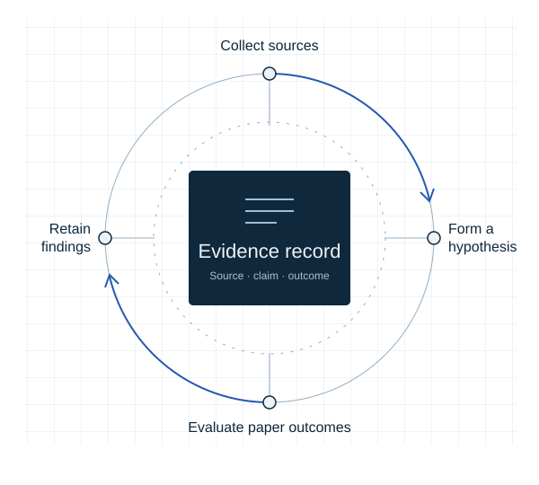
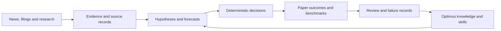
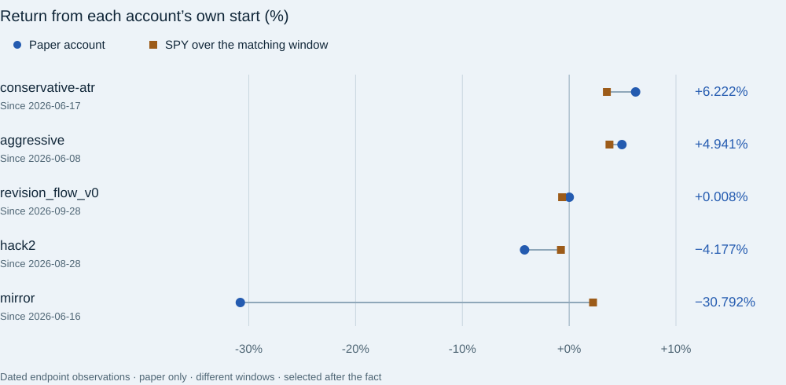

<p align="center"></p>

# Aegis Finance

**A work-in-progress market research platform connecting evidence, quantitative experiments and measurable outcomes.** Built by [Murathan Abdullaev](https://murathan.info).

This repository is a curated public showcase. The original implementation remains private to protect confidential data and operational material. Here you can inspect selected aggregate results, system diagrams, methodology and the source of the showcase website.

[Live showcase](https://aegis-finance-showcase.vercel.app) · [Portfolio](https://murathan.info) · [Optimus Brain](https://optimus-brain-alpha.vercel.app) · [Results and provenance](docs/EVIDENCE.md)

## What it does

Aegis brings together source acquisition, market and company research, hypothesis tracking, deterministic portfolio mechanics, forward paper evaluation and persistent research memory. Its engineering focus is keeping sources, interpretations and outcomes connected, including unsuccessful experiments.



Implemented components are not a claim that every scheduled integration is currently qualified. The language model explains and interprets; explicit code computes portfolio mechanics.

## Development snapshot

Checked on **18 October 2026**, against implementation commit `4e19219900c9de9fa35315fec63478783b6af3b5`:

| Measurement | Verified scope |
| --- | --- |
| Reachable commits | **1,990** |
| History begins | **28 March 2026**, more than six months |
| Production source census | **1,180 files** in explicitly selected roots |
| Physical source lines | **520,585**, including blank lines |
| Nonblank source lines | **458,663** |

The bounded census excludes test, data, dependency, vendor and generated paths. These counts describe source-tree scale; they do not measure originality, engineering quality, hours worked or financial performance. [Exact census rules](docs/EVIDENCE.md#verified-development-scale).

Stack: Python, FastAPI, Next.js/React, quantitative experimentation routines, paper-account ledgers and local MCP integrations. The website in this repository is deliberately plain HTML/CSS/JavaScript and has no runtime dependencies.

## Selected paper observations

**Snapshot generated 17 October 2026, 23:51:19 UTC; market marks through 16 October. Paper only.** Of **307** benchmark-comparable accounts, **20 were ahead and 287 behind SPY**. Excluding control twins, **5 of 80** were ahead. These are correlated experiments, not independent trials.



| Paper account | Window start | Return | SPY over the same window |
| --- | --- | ---: | ---: |
| conservative-atr | 17 June 2026 | +6.222% | +3.530% |
| aggressive | 8 June 2026 | +4.941% | +3.774% |
| revision_flow_v0 | 28 September 2026 | +0.008% | −0.664% |
| hack2 | 28 August 2026 | −4.177% | −0.772% |
| mirror | 16 June 2026 | −30.792% | +2.237% |

These examples were selected after observing outcomes and deliberately include losses and previously featured winners. They have different inception dates, are not one combined portfolio and are not an investment recommendation. The chart shows endpoints, not a time series. No independent cost-inclusive audit or demonstrated investment skill is established. Maximum drawdown is unavailable in these receipts and remains unknown.

Inspect the [sanitized JSON](public/data/results.json), [derivation and source hashes](docs/EVIDENCE.md), and [readable methodology](public/methodology.html). Private source hashes identify bytes; they do not allow a public reader to independently audit unavailable originals.

## Optimus and reusable research

[Optimus](https://github.com/Murathanx12/Optimus) is the persistent knowledge and tool layer: source-linked notes, project context, reusable agent instructions and retrieval through MCP. It is a knowledge system, not a newly trained foundation model.

The companion browser research worker adds resumable inventory, original-document preservation, explicit failures and coverage reporting. Repeated collection runs in ordinary code; a model need not decide every click. Collection, evidence processing and research support are potential separate product directions, not already launched commercial services.

## Explore locally

Use Python 3.12 or newer for the build and its directory-link safeguards.

```sh
git clone https://github.com/Murathanx12/AEGIS-FINANCE-SHOWCASE.git
cd AEGIS-FINANCE-SHOWCASE
python scripts/build.py
python -m http.server 8080 --directory public
```

Open `http://localhost:8080`. The build validates the snapshot arithmetic and local links, regenerates the figure, then stages **only `public/`** into `.vercel/output/static`. It calls no finance worker, broker, authenticated browser or model API.

For Vercel, link this checkout to the dedicated **aegis-finance-showcase** project, verify its target with `vercel project inspect`, and run `vercel deploy --prebuilt`. The operational Aegis application is a separate deployment.

## Publication boundary

Included: curated aggregate observations, newly authored diagrams, explanations and site source. Excluded: the private implementation, raw receipts and article corpus, holdings, account identifiers, credentials, personal messages, school documents and full chat/Optimus exports. Software ownership does not automatically convey redistribution rights to source publications.

This is an evolving independent research and engineering project. Further work includes stronger prospective evaluation, reliable attribution from source to decision and careful cross-project automation. Current results remain mixed, and negative findings remain part of the record.
